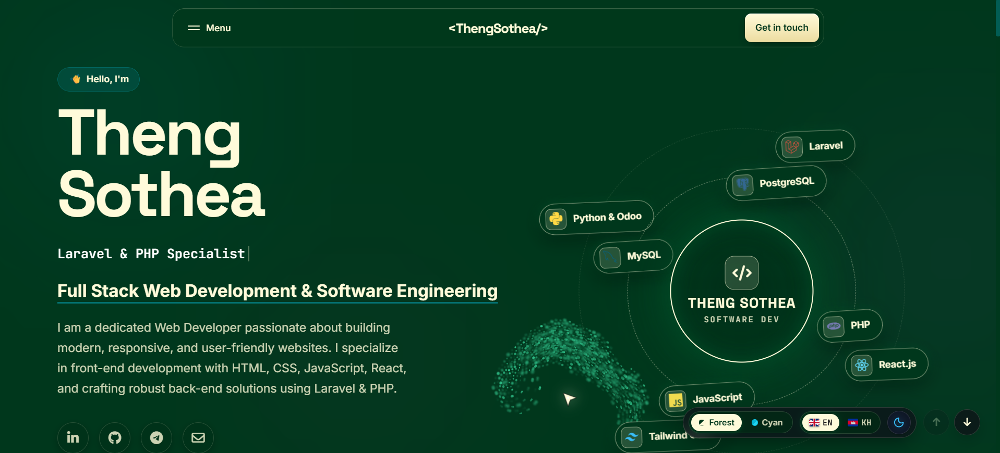

# Theng Sothea — Modern Web Developer Portfolio (v2)

<p align="center">
  
</p>

<p align="center">
  <a href="https://thengsothea-portfolio-v2.vercel.app/"></a>
  
  
  
</p>

<p align="center">
  <a href="#-overview">Overview</a> •
  <a href="#-key-features">Key Features</a> •
  <a href="#-react-bits--webgl-integrations">React Bits & WebGL</a> •
  <a href="#-3d-coverflow-carousel">3D Coverflow</a> •
  <a href="#-featured-projects">Projects</a> •
  <a href="#-project-structure">Project Structure</a> •
  <a href="#-quick-start">Quick Start</a> •
  <a href="#-contact--connect">Contact</a>
</p>

---

## 🌟 Overview

Welcome to the **v2 Portfolio Website** of **Theng Sothea**, a Full-Stack Web Developer based in Phnom Penh, Cambodia. Specializing in **Laravel, PHP, JavaScript, React.js, Python/Django, and MIS Management Systems**, this portfolio represents an intersection of high-fidelity aesthetics, modern WebGL physics, and performance-first web architecture.

Crafted with clean semantic HTML5, modern CSS3 variables, and modular vanilla JavaScript engines, the portfolio achieves native 60 FPS fluidity with **zero heavy runtime framework overhead**.

> **Live Deployment:** [thengsothea-portfolio-v2.vercel.app](https://thengsothea-portfolio-v2.vercel.app/)

---

## 🎨 Dual Aesthetic Design System

Switch between two completely bespoke themes at runtime or open them as standalone templates:

| Template | Primary Accents | Surface / Mood | Live Standalone Link |
|:---|:---|:---|:---|
| **Cyber Cyan** *(Default)* | `#06b6d4`, `#22d3ee`, `#0891b2` | Obsidian Dark (`#07080c`), Glassmorphism, Neon Sci-Fi | [`template-cyan.html`](template-cyan.html) |
| **Forest & Cream** | `#00371c`, `#10b981`, `#047857` | Deep Botanical Emerald, Warm Cream (`#fffbda`), Organic Modern | [`template-forest.html`](template-forest.html) |

*Both templates seamlessly support instant **Dark Mode** and **Light Mode** toggles with persistence via `localStorage`.*

---

## 🚀 Key Features

- **🌐 Complete Bilingual Localization (EN / KM)**:
  - Full toggle between English and Khmer (ភាសាខ្មែរ).
  - Authentic typography powered by Google Font **Kantumruy Pro** for Khmer and **Plus Jakarta Sans** for English.
  - Comprehensive translation matrix covering navigation, hero, bios, skills, timeline, projects, education, guestbook, and footer.
- **🧭 React Bits `<CardNav />` Floating Navigation**:
  - Open-source navigation bar with interactive spring unroll/rise animation.
  - Multi-card mega menu (`cardEffect="rise"`), quick jump links, mobile touch sheet drawer, and direct CTA actions.
- **🐝 Global `<SwarmCursor />` Fluid Simulation**:
  - Full-screen WebGL 2 particle swarm (800+ dynamic particles) that flows across the entire viewport.
  - Features curl noise, cursor swirl, velocity trails, click burst splashes, and target flocking around interactive links and buttons.
- **🃏 3D Perspective Coverflow Project Carousel**:
  - Interactive stage with elevated center card, smooth `scale` & `rotateY` depth, and circular frosted-glass floating stage navigation arrows.
- **🪪 React Bits `<Lanyard />` 3D Interactive Badge**:
  - Three.js + Rapier physics simulation rendering a draggable, swinging identity badge in the About section.
- **🏔️ React Bits `<Topography />` WebGL 2 Welcome Screen**:
  - Interactive 3D contour terrain with mouse wake and ambient lighting.
- **💬 Interactive Community Guestbook**:
  - Visitor feedback board with live submission, auto-scrolling ticker, hover pause, and `localStorage` persistence.
- **📄 Curriculum Vitae PDF Viewer Modal**:
  - In-browser full document preview of `THENG-SOTHEA_CV.pdf` with direct download and open-in-tab actions.

---

## 🔮 React Bits & WebGL Integrations

| Component | Architecture | Description | Files |
|:---|:---|:---|:---|
| **`<CardNav />`** | CSS3 Transforms & Vanilla JS | Spring-animated floating navigation bar with categorized cards and mobile drawer. | [`js/card-nav.js`](js/card-nav.js)<br>[`css/CardNav.css`](css/CardNav.css) |
| **`<SwarmCursor />`** | WebGL 2 & GPGPU Particles | 800-particle fluid curl-noise swarm with target flocking and click burst effects. | [`js/swarm-cursor.js`](js/swarm-cursor.js)<br>[`css/SwarmCursor.css`](css/SwarmCursor.css) |
| **`<Topography />`** | WebGL 2 Elevation Shader | Dynamic contour wave background on the cinematic welcome screen overlay. | [`js/topography.js`](js/topography.js)<br>[`css/Topography.css`](css/Topography.css) |
| **`<Lanyard />`** | Three.js & Rapier Physics | 3D draggable physical ID badge with realistic strap kinematics and texture mapping. | [`js/lanyard.js`](js/lanyard.js)<br>[`css/Lanyard.css`](css/Lanyard.css) |
| **`<ReflectiveCard />`** | CSS 3D & Pointer Tracking | Dynamic specular sheen and interactive card tilting micro-interactions. | [`js/reflective-card.js`](js/reflective-card.js)<br>[`css/ReflectiveCard.css`](css/ReflectiveCard.css) |
| **`<GyroscopeCursor />`** | 3D Perspective Matrix | Spatial orientation follower that rotates elements based on cursor trajectory. | [`js/gyroscope-cursor.js`](js/gyroscope-cursor.js)<br>[`css/GyroscopeCursor.css`](css/GyroscopeCursor.css) |

---

## 🎡 3D Coverflow Project Carousel

The Featured Projects section (`#projects`) uses a **3D Coverflow Perspective Stage**:

```
        [ Card -2 ]      [ Card -1 ]      ┏━━━━━━━━━━━━━━━┓      [ Card +1 ]      [ Card +2 ]
        scale: 0.76      scale: 0.88      ┃ ACTIVE CENTER ┃      scale: 0.88      scale: 0.76
       rotateY: 22°     rotateY: 14°      ┃  scale: 1.02  ┃     rotateY: -14°    rotateY: -22°
       opacity: 0.65    opacity: 0.88     ┃  opacity: 1   ┃     opacity: 0.88    opacity: 0.65
                                          ┗━━━━━━━━━━━━━━━┛
```

- **Floating Stage Arrows**: Circular frosted-glass buttons (`‹` on the left, `›` on the right) vertically centered over the stage.
- **Side-Card Click-to-Center**: Clicking any side card immediately animates it into the active center position.
- **Touch & Mouse Drag Support**: Swipe left or right on mobile or drag on desktop to advance slides.
- **Throttled Mouse Wheel**: Effortlessly cycle through projects using the trackpad or mouse wheel.
- **Synchronized Controls**: Top header controls (Prev, Next, AutoPlay toggle, live counter `01 / 06`) and bottom pagination dots stay synchronized.
- **Dynamic Category Filtering**: Seamlessly filter between **All Projects**, **Web & Full-Stack**, and **Systems & Software**.

---

## 💼 Featured Projects

| Project | Tech Stack | Highlights | Links |
|:---|:---|:---|:---:|
| **Business Cambodia Clone** | HTML5, CSS3, JavaScript | Modern news portal featuring responsive editorial layout, categorized article streams, and article reading experience. | [Live Demo](https://businesscambodia-website-news-clone.vercel.app/) • [GitHub](https://github.com/theinvinciblebe/businesscambodia-website-news-clone) |
| **School Management System** | Laravel, PHP, MySQL, Bootstrap | Institutional management platform with RBAC roles (Admin, Teacher, Student), grade tracking, and fee records. | [Video Demo](https://youtu.be/4eQ_eWbT64w?si=m9rYvXp-v3q3c69y) • [GitHub](https://github.com/theinvinciblebe/School-Management-System-using-Laravel-10-and-mysql) |
| **CMS Gaming Product** | Laravel, PHP, MySQL, Bootstrap | Full-featured CMS with digital game catalog, inventory control, automated invoice generation, and financial logs. | [Live Demo](https://cms-game.infinityfreeapp.com) • [GitHub](https://github.com/theinvinciblebe/CMS-FOR-SELL-PRODUCT-GAME) |
| **BookStore POS System** | Java, Maven, MySQL, Swing | Desktop POS system handling cashier checkout, real-time stock deductions, receipt printing, and daily reconciliation. | [Video Demo](https://youtu.be/813iL3zW-a8?si=Z6vT1r_U2n3n_dG7) • [GitHub](https://github.com/theinvinciblebe/BookStore_Management_System_Java_Swing) |
| **E-Commerce Application** | Python, Django, SQLite, Bootstrap | Online store featuring product catalog, customer shopping carts, checkout workflows, and order status tracking. | [Video Demo](https://youtu.be/zD1vF2k5n-E?si=HqVn3M9fA3rG6xL1) • [GitHub](https://github.com/theinvinciblebe/ecommerce-website-django) |
| **Depreciation System** | PHP, MySQL, Accounting Logic | Asset management system calculating straight-line and accelerated depreciation, ledger history, and report exports. | [Live Demo](https://depreciationssystem.vercel.app/) • [GitHub](https://github.com/theinvinciblebe/Depreciation-System) |

---

## 📁 Project Structure

```text
thengsothea-portfolio-v2/
├── assets/                  # High-res portraits, project screenshots, CV PDF, flag SVGs
│   ├── business_cambodia_screen.png
│   ├── depre_system.png
│   ├── sothea_pf.png
│   └── ...
├── css/                     # All application & component stylesheets
│   ├── style.css            # Master styles: design tokens, 3D Coverflow, & responsive layout
│   ├── CardNav.css          # Styling & spring animations for CardNav mega menu
│   ├── SwarmCursor.css      # Styling for global viewport particle container
│   ├── Topography.css       # Canvas container styling for Topography
│   ├── Lanyard.css          # Three.js 3D badge viewport styling
│   ├── ReflectiveCard.css   # Dynamic sheen and reflective tilt styling
│   └── GyroscopeCursor.css  # Cursor perspective follower styling
├── js/                      # Vanilla JavaScript controllers & WebGL physics engines
│   ├── script.js            # Core application controller (3D Coverflow, i18n, guestbook)
│   ├── card-nav.js          # Controller for React Bits <CardNav /> floating navigation
│   ├── swarm-cursor.js      # WebGL 2 GPGPU 800+ particle curl-noise swarm simulation
│   ├── topography.js        # Pure WebGL 2 elevation contour shader engine
│   ├── lanyard.js           # Three.js + Rapier physics engine for 3D interactive badge
│   ├── lanyard.esm.js       # ES Module adapter for Three.js dependencies
│   ├── reflective-card.js   # Dynamic specular sheen micro-interaction engine
│   └── gyroscope-cursor.js  # 3D tilt & cursor perspective follower
├── components/              # Original React Bits source components (JSX)
│   ├── CardNav.jsx          # React Bits navigation component reference
│   ├── SwarmCursor.jsx      # React Bits particle swarm component reference
│   ├── Topography.jsx       # React Bits elevation contour terrain reference
│   ├── Lanyard.jsx          # React Bits 3D interactive badge reference
│   ├── ReflectiveCard.jsx   # React Bits reflective card reference
│   └── GyroscopeCursor.jsx  # React Bits gyroscope tracker reference
├── index.html               # Main portfolio entry with interactive template switcher
├── template-cyan.html       # Standalone Edition: Cyber Cyan (#06b6d4 & #22d3ee)
├── template-forest.html     # Standalone Edition: Forest & Cream (#00371c & #fffbda)
├── components.json          # Shadcn / React Bits registry configuration
├── .env.example             # Environment configuration template
├── .gitignore               # Git ignored patterns
└── README.md                # Comprehensive documentation
```

---

## ⚡ Performance & Optimization Highlights

1. **Hardware Acceleration**:
   - All 3D transformations utilize `translate3d`, `rotateY`, and `scale` with `backface-visibility: hidden` to leverage GPU compositing layers.
2. **IntersectionObserver Throttling**:
   - WebGL render loops (`Topography`, `Lanyard`) and the Coverflow auto-slider pause execution automatically when out of viewport or when the browser tab is hidden.
3. **Adaptive DPR Capping**:
   - Canvas device pixel ratios are capped at `Math.min(window.devicePixelRatio, 2)` to eliminate excess GPU overhead and conserve battery on high-density mobile screens.
4. **Zero Heavy Framework Runtime**:
   - Pure vanilla JavaScript with no bloated virtual DOM bundle, yielding lightning-fast First Contentful Paint (FCP) and instantaneous Time to Interactive (TTI).

---

## 🚀 Quick Start & Local Development

No package installation or compilation is required. You can serve the static files with any local HTTP server:

### Option 1: Python 3
```bash
python -m http.server 3000
```

### Option 2: Node.js (npx serve)
```bash
npx serve -l 3000
```

### Option 3: PHP Built-in Server
```bash
php -S localhost:3000
```

### Option 4: VS Code Live Server
Right-click on `index.html` and select **"Open with Live Server"**.

Visit **[http://localhost:3000](http://localhost:3000)** in your browser.

---

## 📬 Contact & Connect

**Theng Sothea**  
*Full Stack Web Developer & MIS Graduate (2026)*  
Phnom Penh, Cambodia

- **Email:** [sotheatheng2002@gmail.com](mailto:sotheatheng2002@gmail.com)
- **Phone:** `+855 867 248 55`
- **Telegram:** [@sotheatheng2002](https://t.me/sotheatheng2002)
- **LinkedIn:** [linkedin.com/in/theng-sothea-2b0327306](https://www.linkedin.com/in/theng-sothea-2b0327306/)
- **GitHub:** [github.com/theinvinciblebe](https://github.com/theinvinciblebe)

---

<p align="center">
  <sub>Designed & Developed with ❤️ by Theng Sothea © 2026. All rights reserved.</sub>
</p>
